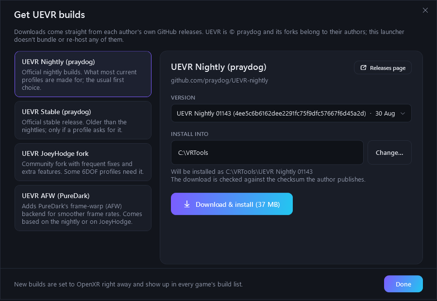

# HeadStart VR

**One-click UEVR launcher for playing flat Unreal Engine games in VR.**
Click Launch, put your headset on, play. HeadStart VR waits until your headset is really connected, starts the
game, lets it reach its menu and injects the right [UEVR](https://github.com/praydog/UEVR) build for that game,
then gets out of your way. Once the headset is on, nothing needs a click.


## Why

Injecting UEVR by hand has a few traps:

- **UEVR checks for the headset exactly once**, at injection. If your headset isn't connected yet (asleep, or
  Virtual Desktop not streaming), VR silently fails and the game stays flat.
- Many games need **their own UEVR build or fork** and **their own profile**, and profiles get updated often.
- The UEVR injector must target the real `…-Win64-Shipping.exe`, not the launcher stub, and run as administrator.

HeadStart VR handles all of that per game.

## Features

- **Headset check before every launch**: the same OpenXR check UEVR does (`xrGetSystem`), so injection only happens
  when VR will actually start. Works with Virtual Desktop, SteamVR, Air Link, Steam Link or a cable.
- **Hands-free after the headset is on**: a countdown lets the game reach its menu, then UEVR is injected as
  administrator. If VR still doesn't start, the game is restarted and injected again automatically. Spoken
  prompts tell you what's happening.
- **Any UEVR build per game**: pick from builds found on your PC, any folder, or **download** official nightlies,
  stable, the JoeyHodge fork or PureDark's AFW straight from their GitHub releases (checksum-verified when
  published). New builds are set to OpenXR automatically.
- **Profile management**: drop a downloaded profile zip in your Downloads folder and it's offered for the right
  game. Every update or restore **backs up the current profile first**, and any backup can be restored.
- **Game library**: scans Steam, Epic, GOG, Xbox app and `Games` folders for Unreal Engine games and finds the real
  game exe (including renamed ones).
- **Optional extras**: starts Virtual Desktop Streamer, walks you through arming
  [OFXR Bridge](https://github.com/tig3rmast3r/OFXR-Bridge) frame generation, desktop shortcuts per game
  (`HeadStartVR.exe --launch <game>`), Back + Start on a controller to inject early.

| Launching | Get UEVR builds |
|---|---|
|  |  |

## Requirements

- Windows 10 or 11 (64-bit)
- [.NET 10 Desktop Runtime](https://dotnet.microsoft.com/download/dotnet/10.0) (x64)
- A PC VR setup with an OpenXR runtime (Virtual Desktop, SteamVR or Meta Quest Link)
- An Unreal Engine 4/5 game that UEVR supports (no anti-cheat)

## Install

1. Download `HeadStartVR.zip` from [Releases](../../releases) and unzip it into a folder you own,
   for example `C:\VR\HeadStartVR` (it keeps its library and backups in a `data` folder next to the exe).
2. Run `HeadStartVR.exe`. Windows asks for administrator rights; see below for why.
3. Click **Scan** (or **Add game**), pick each game's UEVR build, and press **Launch in VR**.

The exe isn't code-signed, so Windows SmartScreen may warn the first time: choose **More info → Run anyway**,
or build it yourself from source.

## Why it asks for administrator rights

The UEVR injector has to run as administrator to inject into games. Asking once when you open HeadStart VR
means no permission prompt pops up later while you're wearing the headset. Games, Steam, Virtual Desktop and
OFXR are still started as your normal user.

## Privacy

- No accounts, no telemetry, no analytics.
- The only internet access is **Get UEVR builds**, which talks to GitHub when you open it.
- Your library, settings, log and profile backups stay in the `data` folder next to the exe.

## Profiles

UEVR profiles are made by community authors and are matched by the game's exe name
(`%APPDATA%\UnrealVRMod\<GameExe>`). **Find online…** opens the Flat2VR Discord (where most profiles are posted),
Nexus Mods or a web search. Save the zip to Downloads and HeadStart VR offers it for the right game.
Profiles that contain plugin DLLs run code inside the game; you're warned before installing one.

## Build from source

```
dotnet test tests/HeadStartVR.Tests
dotnet publish src/HeadStartVR -c Release -o publish -p:PublishSingleFile=true -p:IncludeNativeLibrariesForSelfExtract=true
```

Needs the .NET 10 SDK. Every push is built and tested by GitHub Actions; tagged versions (`v*`) are published to
Releases with a SHA-256 checksum.

## Credits

UEVR is made by [praydog](https://github.com/praydog/UEVR) and is © its author; HeadStart VR doesn't include or
re-host it. Thanks to the authors of the UEVR forks, OFXR Bridge and the Flat2VR community. See
[THIRD-PARTY-NOTICES.md](THIRD-PARTY-NOTICES.md).

HeadStart VR is an independent project, not affiliated with UEVR, Flat2VR, Virtual Desktop, Meta, Valve or Epic.

## License

[MIT](LICENSE)
