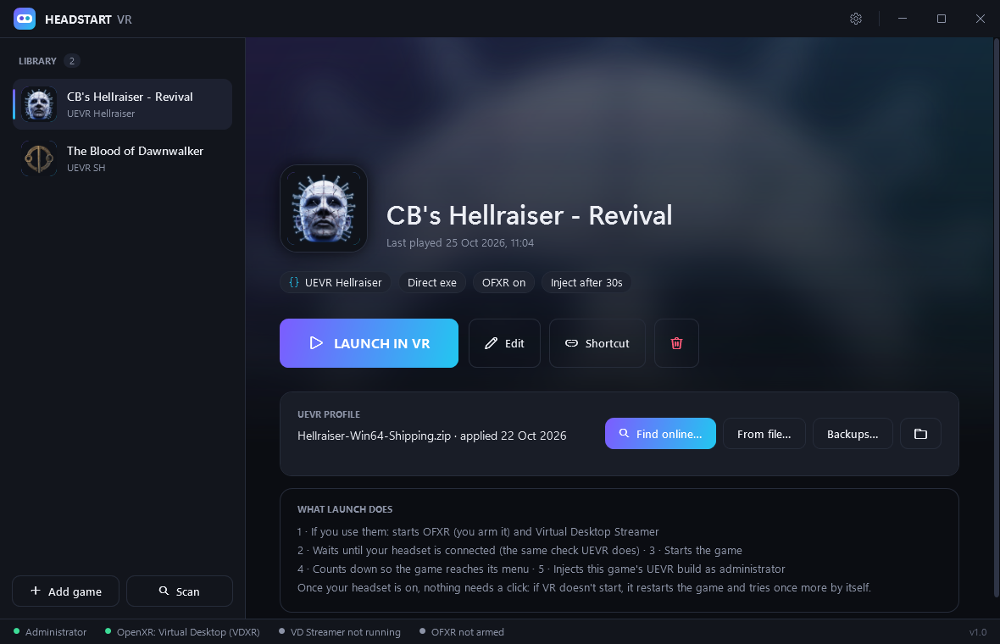
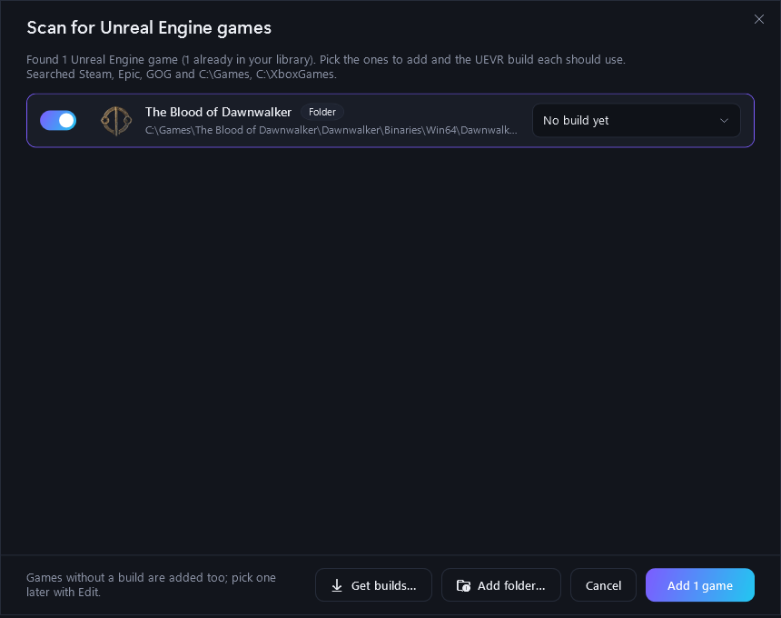
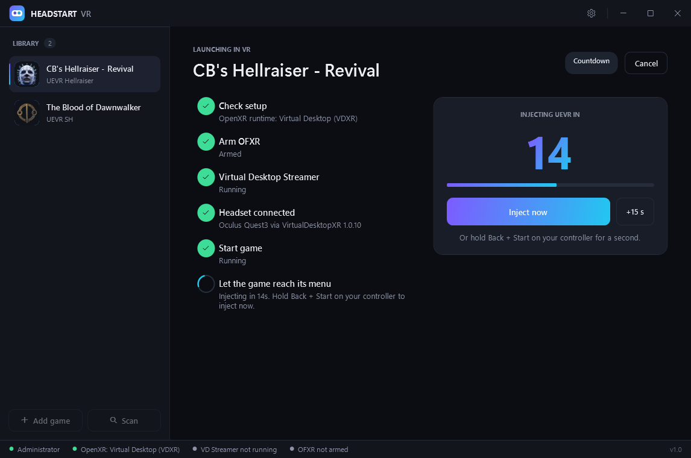

# HeadStart VR

**Play your flat Unreal Engine PC games in VR — with one click.**

Click **Launch in VR**, put on your headset, and play. HeadStart VR starts the game and turns on VR for you,
at the right moment, every time.



---

## What is this?

[UEVR](https://github.com/praydog/UEVR) (by praydog) is a free mod that makes many games built with
**Unreal Engine 4 and 5** playable in VR. Using it by hand is fiddly, though:

- You start the game, then run the UEVR injector **as administrator**, pick the right process and click
  **Inject** at the right moment.
- If your headset isn't connected yet when you inject (asleep, or not streaming), **VR silently fails** and the
  game stays flat. You have to restart the game and try again.
- Many games need **their own UEVR version** and **their own settings file ("profile")**, which get updated often.

**HeadStart VR does all of that for you, for each game.** You set a game up once; after that it's one click.

## What you need

- A Windows 10 or 11 PC (64-bit)
- A PC VR headset that's connected to your PC through **Virtual Desktop, SteamVR, Air Link / Quest Link, Steam Link
  or a cable**
- The [.NET 10 Desktop Runtime](https://dotnet.microsoft.com/download/dotnet/10.0) (x64). If it's missing,
  Windows shows a message with a download link the first time you open HeadStart VR.
- Games made with **Unreal Engine 4 or 5**. Games with anti-cheat don't work with UEVR.

## Getting started

**1. Download and open it**

- Download **`HeadStartVR.zip`** from the [Releases page](../../releases) and unzip it to a folder of your own,
  for example `C:\VR\HeadStartVR`. (Avoid `Program Files`.)
- Open **`HeadStartVR.exe`** and click **Yes** when Windows asks for administrator rights
  ([why?](#why-does-it-need-administrator-rights)).
- Windows may show a blue *"Windows protected your PC"* box because the app isn't code-signed.
  Click **More info → Run anyway**.

**2. Add your games**

- Click **Scan**. HeadStart VR looks through your Steam, Epic, GOG and Xbox app libraries and any `Games` folders
  and lists the Unreal Engine games it finds. Tick the ones you want.
- Game somewhere else? Use **Add folder…** in the Scan window, or **Add game** and pick the game's
  `…-Win64-Shipping.exe` (it's inside the game's `<Name>\Binaries\Win64` folder — not the `.exe` in the game's
  main folder).



**3. Pick a UEVR version for each game**

- Each game needs a UEVR build (the UEVR program files). HeadStart VR finds builds you've already unzipped in
  common places like Downloads, Desktop or `C:\UEVR`; anywhere else, pick it with **Other folder…** or add the
  folder in **Settings**.
- Don't have one? Click **Get builds…** (in the Scan window, the game's **Edit** form or **Settings**), choose
  **UEVR Nightly** and click **Download & install**. That's the right choice for most games. If a game's profile
  says it needs a different version, get that one.

**4. Get the game's profile (recommended)**

- A profile contains the VR settings and fixes someone made for that game. On the game's page, click
  **Find online…** → **Open Discord**. The [Flat2VR](https://flat2vr.com) Discord is where most profiles are
  posted; your game's name is copied so you can paste it into Discord's search.
- **Save the profile `.zip` to your Downloads folder.** HeadStart VR notices it and offers to install it for the
  right game. Your previous profile is backed up first. (It recognises zips named after the game's exe, like
  `MyGame-Win64-Shipping.zip`, or that contain a folder with that name. For anything else, use **From file…** on
  the game's page.)

**5. Play**

- Click **LAUNCH IN VR** and put your headset on when you're asked to. That's it.



## What happens when you click Launch in VR

1. **Quick checks**: is the game's UEVR version set to OpenXR, is your VR software set up, is there a newer profile
   to install? Anything that needs your answer is asked *now*, before you put the headset on.
2. **Optional helpers**: starts Virtual Desktop Streamer and reminds you to arm OFXR frame generation, but only if
   you have them installed.
3. **Waits for your headset**: it checks, the same way UEVR does, that your headset is connected and ready.
   You'll hear *"Headset connected."*
4. **Starts the game** and counts down (25 seconds by default) so the game reaches its main menu.
5. **Turns on VR** by injecting the game's UEVR version, then checks that VR actually started.

**From the moment your headset is on, nothing needs a click.** Spoken messages tell you what's going on. If VR
doesn't start, HeadStart VR restarts the game and tries once more by itself.

## Handy extras

- **Inject sooner**: click **Inject now**, or hold **Back + Start** on an Xbox-style controller for a second.
- **Longer intros?** Raise the game's countdown with **Edit**.
- **Desktop shortcut**: **Shortcut** puts a "*Game* (VR)" icon on your desktop that launches straight into VR.
- **Undo a profile update**: **Backups…** lists every earlier version of a game's profile; click **Restore**.
- **Game won't start from its exe?** In **Edit**, set *Start the game* to **Through Steam** or **Launcher link**.

## Troubleshooting

**The game started but stayed flat (no VR)**
Make sure your headset is connected in your VR software before launching. The status bar at the bottom shows
which OpenXR runtime Windows uses. It should be your VR software (for example Virtual Desktop or SteamVR).
If VR still doesn't start, try another UEVR version (**Get builds…**) or a longer countdown. The launch screen
says what went wrong.

**My game isn't in the Scan list**
Click **Add folder…** and pick the folder where you keep it, or use **Add game**. Only Unreal Engine games are
listed.

**It crashes when UEVR is injected**
Try a longer countdown so the game is fully at its menu, a different UEVR version, or check the game's profile
notes on Flat2VR. Turn off in-game frame generation and HDR, and close overlays such as RivaTuner.

**Which UEVR version should I use?**
Start with **UEVR Nightly**. Use the JoeyHodge fork or PureDark's AFW only when a profile asks for it.

**Do I need Virtual Desktop or OFXR?**
No. Both are optional; HeadStart VR skips them if they aren't installed.

## Why does it need administrator rights?

The UEVR injector has to run as administrator to work. By asking once when you open HeadStart VR, no permission
pop-up appears later while you're wearing the headset. Your games, Steam, Virtual Desktop and OFXR still run as
your normal user.

## Privacy and safety

- No accounts, no ads, no tracking.
- It only goes online when you open **Get builds…**, to download UEVR straight from its authors' GitHub pages.
- Your library, settings and profile backups stay in the `data` folder next to `HeadStartVR.exe`.
- Profiles that contain plugins (`.dll` files) run code inside the game; you're warned before installing one.
- To uninstall, close HeadStart VR and delete its folder. Your UEVR profiles stay in `%APPDATA%\UnrealVRMod`.

## For developers

```
dotnet test tests/HeadStartVR.Tests
dotnet publish src/HeadStartVR -c Release -o publish -p:PublishSingleFile=true -p:IncludeNativeLibrariesForSelfExtract=true
```

Needs the .NET 10 SDK. WPF app in `src/HeadStartVR`, tests in `tests/`. Every push is built and tested on GitHub;
version tags (`v*`) publish `HeadStartVR.zip` with a SHA-256 checksum to Releases.

<details>
<summary>How the headset check works</summary>

UEVR calls OpenXR's `xrGetSystem` once, when it's injected. If no headset is available at that moment, the
runtime returns `XR_ERROR_FORM_FACTOR_UNAVAILABLE` and UEVR stays flat. HeadStart VR makes the same call
(in a separate process, using the game's own UEVR `openxr_loader.dll`) every couple of seconds and only injects
once it succeeds. It also sets each UEVR build's saved runtime choice to OpenXR, since the injector defaults to
OpenVR.
</details>

## Credits

UEVR is made by [praydog](https://github.com/praydog/UEVR) and belongs to its author; HeadStart VR doesn't include
or re-host it. Thanks to the authors of the UEVR forks, [OFXR Bridge](https://github.com/tig3rmast3r/OFXR-Bridge)
and the Flat2VR community. See [THIRD-PARTY-NOTICES.md](THIRD-PARTY-NOTICES.md).

HeadStart VR is an independent project and isn't affiliated with UEVR, Flat2VR, Virtual Desktop, Meta, Valve,
Epic or GOG.

## License

[MIT](LICENSE)
